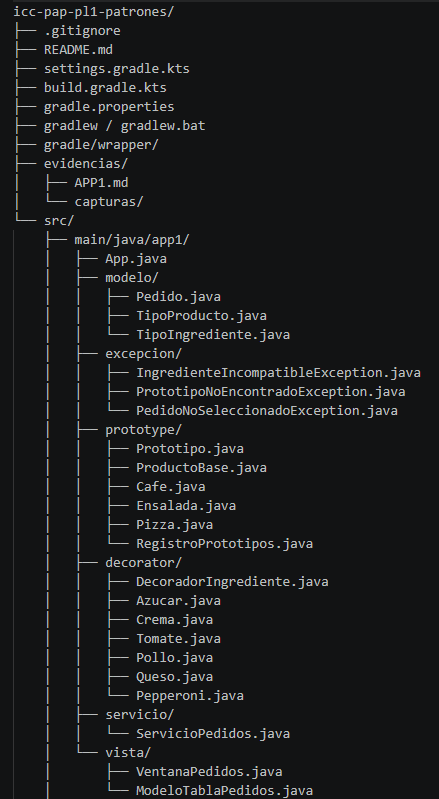
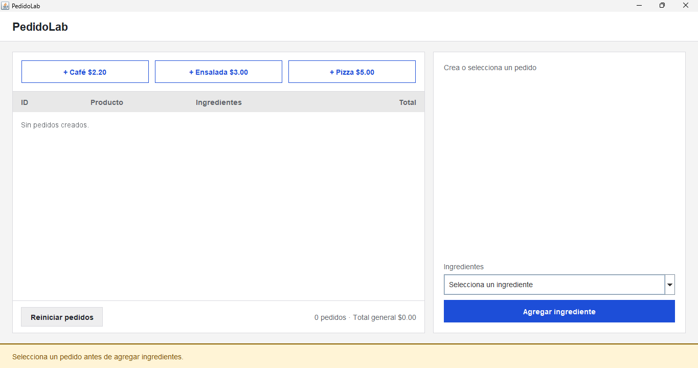
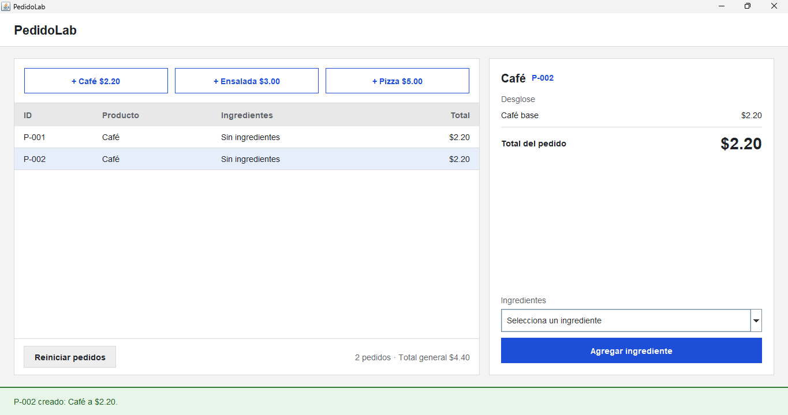
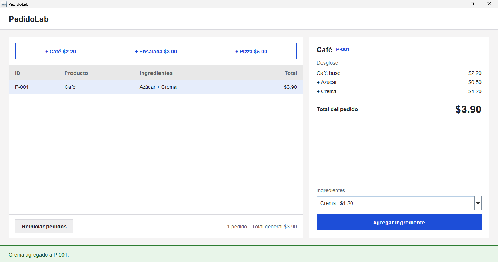
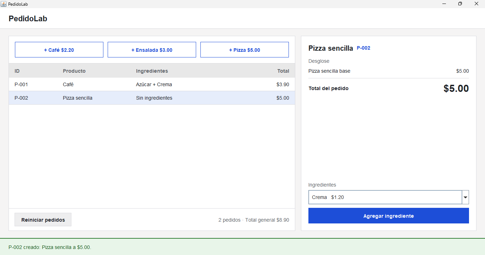
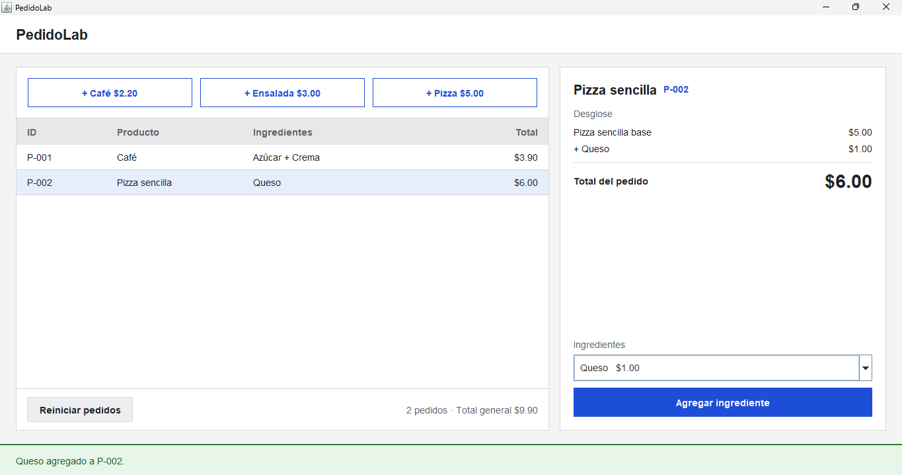
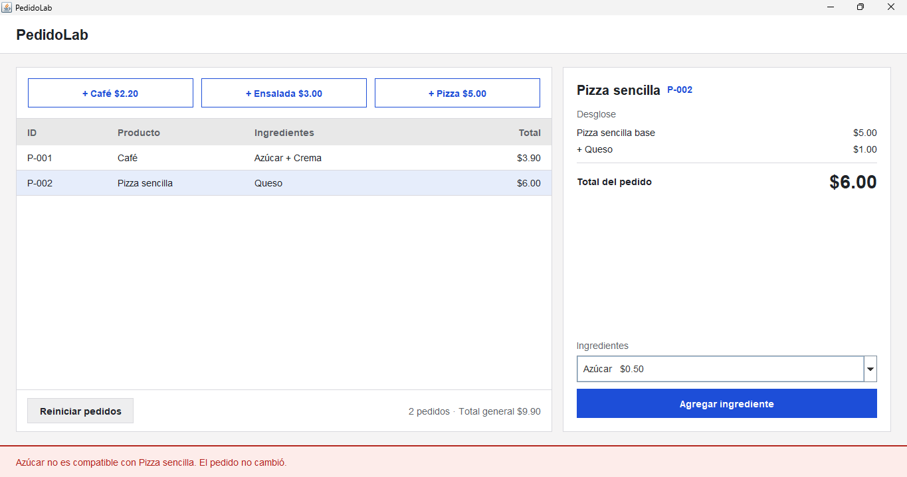

## Nombre: 
Jorge Luis Padilla
## Descripción del proyecto:

Esta es una aplicación en Java que simula el sistema de pedidos de una cafetería universitaria, llamado PedidoLab. El usuario crea pedidos de Café, Ensalada o Pizza y los personaliza con ingredientes, viendo el desglose y el total en tiempo real.
El proyecto demuestra dos patrones de diseño trabajando juntos:
Prototype: cada pedido nuevo es una copia independiente de un producto base guardado en un registro, con su propio ID (P-001, P-002...).
Decorator: cada ingrediente envuelve al pedido existente y suma su descripción y precio, sin crear una clase por cada combinación.

## Estructura base-plantilla del proyecto:

## Capturas mockup exportada desde Figma:

# Pruebas del proyecto Completo:

## App recién abierta, sin crear nada: pulsa Agregar ingrediente
    

## Clic en + Café dos veces

## Selecciona P-001, agrega Azúcar y luego Crema

## Clic en la fila P-002

## Con P-002 seleccionado, elige Queso y pulsa Agregar

## Con P-002, agrega Azúcar dos veces

## 